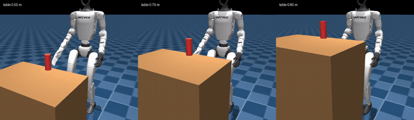

# SuperMimic-Grasp

[SuperMimic project page](https://supermimic.github.io) | [SuperMimic paper](https://arxiv.org/abs/2610.28480)

SuperMimic-Grasp extends [SuperMimic](https://supermimic.github.io) from whole-body motion tracking to **whole-body grasping**. It trains a Unitree G1 humanoid with an Inspire dexterous hand to bring its whole body into position, grasp an object and lift it. Training runs inside one learned, differentiable world model.

## What to do in repos?
- one right-hand grasp of one static cylinder (radius 3 cm, height 15 cm, 0.3 kg);
- a table whose height varies from 0.55 to 0.85 m, so that the robot must squat or lean;
- a policy that observes the object state from the simulator, with no perception yet.
### Results (v1)



*Trained policy in simulation (MuJoCo Warp), one full clip per table height: reach, side approach, grasp, lift and hold.*

The policy was trained for 20,000 iterations with 4,096 parallel environments. That took about 1 hour on one RTX 4090.

It was evaluated on 2,048 environments, starting each episode from a reference frame. An episode counts as **lifted** when it reaches the end of its clip with the object at least 8 cm above its resting height.

| Episode starts in phase | Object lost | Lifted ≥ 8 cm |
|---|---|---|
| settle / reach (full grasp from free space) | 0.3–1.5% | **98.4–99.4%** |
| approach / close | 6% | 94% |
| lift / hold (object already in the hand at reset) | 20–23% | 72–80% |
## How the pipeline works

```
 (1) robot model ──► (2) reference clips ──► (3) simulation task ──► (4) world model ──► (5) policy learning
   G1 + Inspire        IK + physics check      rewards, resets          learned dynamics     in imagination
                                                    ▲                          │                    │
                                                    └──── real transitions ◄───┴──── policy acts ◄──┘
```

Stages 1 and 2 run once, offline. Stages 3–5 form the training loop. The policy collects data in the simulator, the world model learns from that data, and the policy improves by back-propagating through rollouts imagined in the world model.

### 1. Robot model

`src/supermimic/assets/g1_inspire.py` attaches an Inspire hand to the right wrist of mjlab's tuned G1 model. The left hand is unchanged.
- **Joints:** the hand has 12 joints, but only 6 are actuated (thumb yaw, thumb pitch and the four finger bases). The other 6 follow them through MuJoCo equality constraints, which mirror the real hand's linkages.
- **Action:** 35-D, made of 29 body joints and 6 hand joints. Each action is a PD position target.
- **Hand action scale:** body joints use mjlab's G1 action scale. The hand joints use 0.6 rad per unit of action, because the G1 rule would give the weak finger actuators only 0.05 rad, too little to close the hand.

### 2. Reference clips

A motion tracker needs a reference motion. `src/supermimic/grasp/clip_gen.py` generates one clip per sampled scene (table height and object position).

`scripts/gen_grasp_clips.py` writes 300 such clips to `data/grasp_clips/`.

### 3. Simulation task

`SuperMimic-Grasp-G1Inspire` (`src/supermimic/grasp/env_cfg.py`) builds on SuperMimic's tracking task.
- **Scene:** the G1 + Inspire robot, a free cylinder, and a table posed per environment.
- **Resets:** `grasp/command.py` starts each episode from a clip frame chosen by SuperMimic's return-based sampler. It writes the robot, object and table states from that frame. Fingers are reset at first contact rather than at the squeezed reference, which would push the object out of the hand.
- **Rewards:** robot body tracking, as in SuperMimic, plus:
  - object tracking in the world frame;
  - a contact-matching reward that rewards required hand–object contacts and penalizes forbidden ones;
  - hand-joint tracking.
- **Termination:** an episode ends if the robot falls or the object strays more than 10 cm from its reference. The 10 cm threshold is below the lift height, so failing to lift ends the episode.

### 4. World model

The world model replaces the simulator during policy training.
- **State** (`grasp/representation.py`, representation `gencoord_object`): the robot's root and joint state plus the object's pose and velocity, expressed in the robot root frame.
- **Prediction:** one MLP predicts the next state as acceleration-level changes, which are integrated semi-implicitly. It also predicts which hand links touch the object.
- **Training:** an 8-step open-loop loss on replay-buffer windows from the simulator, plus a contact loss.
- **Consistency with the simulator:** imagined rollouts score the same rewards and terminations as the simulator. Per-term differences on real transitions are at most 1.5e-5.

### 5. Policy learning

`learners/policy_learner.py` rolls the actor out for 32 steps inside the world model, starting from states in the replay buffer.
- **Actor update:** the actor maximizes the imagined return directly by back-propagation, bootstrapped by a critic.
- **Actor input:** the world-model state without linear velocities, which a real robot cannot measure reliably, plus a 0.9 s window of future reference frames.
- **Critic input:** the full state.

## How to run

### Setup

Install [uv](https://docs.astral.sh/uv/) and clone this repository next to the mjlab fork:

```bash
curl -LsSf https://astral.sh/uv/install.sh | sh
mkdir supermimic_ws && cd supermimic_ws
git clone https://github.com/daisy14-vr/supermimic-Grasp.git
git clone git@github.com:HybridRobotics/mjlab_research.git
cd supermimic-Grasp
uv sync
```

### 1. Generate reference clips (about 30 minutes)

```bash
uv run src/supermimic/scripts/gen_grasp_clips.py --out-dir data/grasp_clips --num-clips 300
```

### 2. Train

```bash
CUDA_VISIBLE_DEVICES=0 uv run src/supermimic/scripts/train.py SuperMimic-Grasp-G1Inspire \
  --runner.run_name grasp --runner.max-iterations 20000
```

### 3. Play a checkpoint

```bash
uv run src/supermimic/scripts/play.py SuperMimic-Grasp-G1Inspire \
  --checkpoint-dir logs/SuperMimic-Grasp-G1Inspire/<timestamp>
```
## Repository layout

| Path | Role |
|---|---|
| `src/supermimic/assets/` | G1 + Inspire robot model and hand meshes |
| `src/supermimic/grasp/` | clip generation, physics check, task, rewards, world-model representation |
| `src/supermimic/scripts/` | `gen_grasp_clips.py`, `train.py`, `play.py` |
| `src/supermimic/runners/`, `learners/`, `envs/`, `models.py` | SuperMimic training loop, world-model and policy learners |
| `tests/` | unit and integration tests (CPU) |

## Limitations and next steps

- **Scope:** one object, the right hand only, and a fixed stance with no walking to the object.
- **Observation:** the policy observes the object state from the simulator. The planned next step is a depth or point-cloud student distilled from this policy.
- **Mid-grasp resets:** episodes that start with the object already in the hand still lose it 20–23% of the time.
- **Reference clips:** each clip is checked with a single physics trial. Testing several candidate grasps per clip under randomized physics, and choosing the robot's stance by reachability, would make the references more robust.

## Acknowledgements

SuperMimic contains code inspired by these projects:

- [ControlVAE](https://github.com/heyuanYao-pku/Control-VAE) (BSD-3-Clause)
- [robotic_world_model](https://github.com/leggedrobotics/robotic_world_model) (Apache-2.0)
- [DreamerV3](https://github.com/danijar/dreamerv3) (MIT)

The whole-body grasping extension builds on ideas and assets from:

- [mjlab](https://github.com/mujocolab/mjlab) (Apache-2.0): simulation framework, motion command and G1 model.
## License

Copyright 2026 The SuperMimic Authors.

Released under the [Apache License 2.0](LICENSE). This includes the whole-body grasping extension's code. The Inspire hand model and meshes in `src/supermimic/assets/inspire_hand/` are third-party assets and are not covered by this grant.
